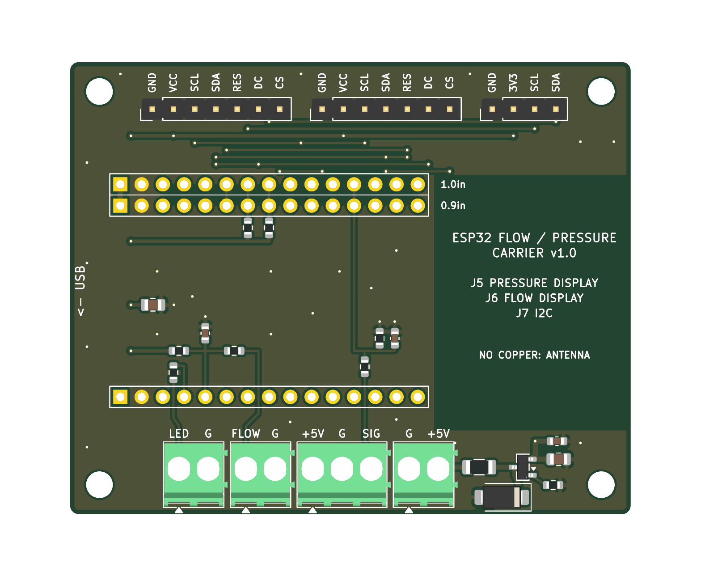

# Carrier PCB

A 2-layer board that replaces the stock ESP32 expansion board and the dupont
harness. The DevKit plugs into it, field wiring lands on screw terminals, and
the displays plug into pin headers.



**To order:** upload [fab/carrier_gerbers.zip](fab/carrier_gerbers.zip) to
JLCPCB, PCBWay or similar. The defaults are fine: 2 layers, 1.6 mm, 1 oz,
HASL. Nothing on this board needs tighter than 0.2 mm track/space or a
0.3 mm via drill.

**For SMD assembly at JLCPCB:** tick *PCB Assembly*, top side, and upload
[fab/carrier_bom_jlc.csv](fab/carrier_bom_jlc.csv) and
[fab/carrier_cpl_jlc.csv](fab/carrier_cpl_jlc.csv). In the placement preview,
check that **Q1**, **D1** (cathode band toward Q1) and **F1** sit on their
pads the right way round. JLC's rotation conventions sometimes differ from
KiCad's for SOT-23 and SMA. Everything through-hole you solder yourself.

## Board

67 × 54 mm. The case's bay was sized around the 67 × 51 expansion board, so
set `exp_wid` to 54 in the case `CONFIG`. See [what the case needs](#the-case).

```
  ┌──────────────────────────────────────────────────────────┐
  │ ○  [J5 pressure disp] [J6 flow disp]   [J7 I2C]        ○ │  headers
  │     ════ channel: SPI bus to both headers ════            │
  │     [ DevKit top row: 1.0in ]                    ┌──────┐ │
  │     [ DevKit top row: 0.9in ]                    │ no   │ │
  │ USB    R6 R7 (I2C pull-ups)                      │copper│ │  DevKit sits
  │ <-     C5                                        │ (ant-│ │  over this,
  │        R5 R1 C3 R2         R3 R4 C4              │ enna)│ │  8.5 mm up
  │     [ DevKit bottom row ]                        └──────┘ │
  │       LED  G FLOW G +5V G SIG   G +5V    F1 Q1 R8 C1 C2   │
  │ ○    [J4 ] [J2   ] [J3       ] [J1  ]    D1             ○ │  terminals
  └──────────────────────────────────────────────────────────┘
          wires enter from the bottom edge
```

- **DevKit (U1):** two 1×15 female headers, USB toward the left wall. The
  bottom row is fixed. The top row has two footprints: one for 1.0" (25.4 mm,
  DOIT DevKit V1) and one for 0.9" (22.86 mm) clones. **Solder a socket into
  only one of them.** The silk marks which is which.
- **Antenna:** neither copper layer has anything under the WROOM antenna end,
  so the ground pour doesn't detune it.
- **Parts under the DevKit:** the 0603 resistors and capacitors sit under the
  DevKit. That's fine because the DevKit sits 8.5 mm up on its sockets.

## Connectors

### Screw terminals: 3.5 mm pitch, wires enter from the board edge

| Ref | Pins (left → right) | Goes to |
|---|---|---|
| J4 LED | LED, G | external status LED, anode to LED. **R5 330 Ω is on the board**, so don't add another. |
| J2 FLOW | FLOW, G | EKM reed switch, either way round. Armor/shield to G here only. |
| J3 PRESSURE | +5V, G, SIG | 0-100 PSI transducer: red, black, signal |
| J1 5V IN | G, +5V | regulated 5 V supply, about 250 mA. **Note G is on the left.** |

Footprint is Phoenix PT 1,5/x-3.5-H. The common blue/green "KF350" / "DB128"
3.5 mm terminals fit the same holes. Buy 2-pin and 3-pin, or click 2-pin
blocks together.

### Headers: 2.54 mm, male

| Ref | Pins (left → right) |
|---|---|
| J5 pressure display | GND, VCC, SCL, SDA, RES, DC, CS |
| J6 flow display | GND, VCC, SCL, SDA, RES, DC, CS |
| J7 I2C | GND, 3V3, SCL, SDA |

J5/J6 follow the pin order printed on the common 7-pin GC9A01 modules, so a
7-way dupont ribbon goes straight across. If your module has an 8th BLK pin,
leave it unconnected; the module pulls it up. **Check your module's order
against the silk before plugging in.** Some makers order them differently, and
then you cross the wires in the ribbon.

## Circuit

Every DevKit pin is the same one the firmware already uses
([src/main.cpp](../../src/main.cpp)), so **no firmware change is needed**.

| Net | DevKit pin | Parts |
|---|---|---|
| FLOW_GPIO | GPIO 4 | R1 1k to 3V3, C3 100 nF to GND, R2 100 Ω to J2 FLOW (the WIRING.md front end) |
| PRES_ADC | GPIO 34 | R3 10k from J3 SIG, R4 10k to GND, C4 100 nF to GND |
| LED_GPIO | GPIO 2 | R5 330 Ω to J4 LED |
| SCLK / MOSI / DC | GPIO 18 / 23 / 16 | both display headers |
| RST_P / CS_P | GPIO 17 / 21 | J5 |
| RST_F / CS_F | GPIO 27 / 22 | J6 |
| SDA / SCL | GPIO 25 / 26 | J7, with R6/R7 4k7 pull-ups to 3V3 |
| +5V | VIN | J3 sensor supply, from J1 through F1, Q1 |
| +3V3 | 3V3 | displays, J7, R1, pull-ups. C5 10 µF bulk. |

**C4 is new.** It's a 100 nF filter across the ADC input. With the 5 kΩ
divider it settles in about 0.5 ms, far faster than the firmware's 0.5 s
average, and it gives the ADC's sampling capacitor a low-impedance source.

### Power input

```
 J1 +5V ──F1 500mA PTC──┬── Q1 AO3401A (P-FET) ──┬── +5V → DevKit VIN, J3
                        │   D        S           │
                     D1 SMAJ5.0A           G ─R8 10k─ GND
                        │                        C1 10µ, C2 100n
                       GND
```

- **Reversed supply:** Q1 stays off and nothing downstream sees it.
  D1 conducts and trips F1.
- **Spike or overvoltage:** D1 clamps it. Unlike a series diode, the
  P-FET drops only millivolts, so the pressure sensor still gets the full
  5 V its 0.5-4.5 V output is scaled against.
- **USB and J1 at the same time:** this is normally fine. DOIT-style DevKits
  have a diode between USB 5 V and VIN, so J1 can't back-feed your computer.
  Clones vary, so check yours has one: a diode on the board next to the USB
  socket. Until you've checked, unplug J1 while programming over USB.

## Parts you solder

| Qty | Part |
|---|---|
| 2 | 1×15 female header, 2.54 mm, 8.5 mm tall (one bottom row, one top row) |
| 2 | 1×7 male header, 2.54 mm |
| 1 | 1×4 male header, 2.54 mm |
| 3 | 2-pin 3.5 mm screw terminal |
| 1 | 3-pin 3.5 mm screw terminal |

Fab-assembled SMD parts are in [the BOM](fab/carrier_bom_jlc.csv). All are
JLCPCB Basic parts except F1 (C315893) and D1 (C83329), which are Extended
and add a small loading fee. Any 1206 PTC around 500 mA hold, and any SMA
5.0 V-standoff unidirectional TVS, will do if those are out of stock.

## The case

Things that change in [../case](../case):

- `exp_wid` 51 → 54. The bay grows 3 mm.
- **The barrel-jack and board-USB holes are no longer needed.** The DevKit USB
  hole stays where it is: the DevKit still points its USB at the left wall,
  centred on the board.
- **Add a cable slot in the bottom wall**, under the terminal row. It spans
  x 11-46 mm from the board's left edge. Measure the wire-entry height on
  your terminal blocks; it's typically 3-6 mm above the board surface.

## Rebuilding

The board is generated, not drawn. Both scripts run in KiCad 10's Python:

```
"%LOCALAPPDATA%\Programs\KiCad\10.0\bin\python.exe" build_pcb.py
"%LOCALAPPDATA%\Programs\KiCad\10.0\bin\python.exe" make_outputs.py
```

[build_pcb.py](build_pcb.py) places and routes everything from the constants
at the top: pin map, terminal order, header positions. It also writes the
DevKit socket footprint into `carrier.pretty/`. [make_outputs.py](make_outputs.py)
refills the ground pours, **refuses to continue unless DRC is clean**, then
writes the Gerbers, drill files, zip, BOM, CPL and renders into `fab/`.

You can open `carrier.kicad_pcb` in KiCad and edit it by hand, but the next
`build_pcb.py` run overwrites the board. Either keep changes in the script, or
stop using the script.

There is **no schematic**. The netlist lives in `DEVKIT_NETS` and the
per-part `two_pin(...)` calls in build_pcb.py, and the table above is its
readable form.

The routing works like this:
- **Display bus:** each display net rises from the DevKit's bottom row on
  B.Cu, through a gap in the top row, into the channel under the headers.
- **Channel:** each net has its own F.Cu level there, so they can reorder into
  the modules' pin order. B.Cu stubs then drop into the header pins.
- **+5 V:** runs on B.Cu along the bottom edge and up the left side.
